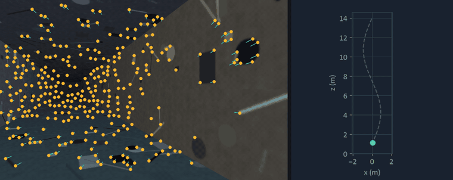
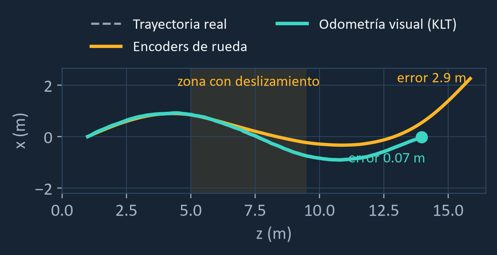

# Etapa 01, pregunta 6: simulación de odometría visual con tracking KLT

## Planteamiento

La pregunta 6 trata la relación entre el tracking y la odometría visual. Para mostrarla con un ejemplo propio se simula un robot que recorre un pasillo: el tracking de puntos (KLT) es la base sobre la que la odometría visual estima el movimiento de la cámara.

## Solución

`klt_sim.py`:

1. **Escena sintética:** renderiza un pasillo 3D texturizado mediante ray casting, visto por una cámara que sigue una trayectoria conocida (ground truth).
2. **Tracking:** sigue esquinas entre frames con el flujo óptico Lucas-Kanade piramidal de OpenCV (KLT).
3. **Odometría visual:** estima el movimiento entre frames con la matriz esencial y `cv2.recoverPose`, y lo acumula. La escala se toma del ground truth, porque una cámara monocular no la puede recuperar.
4. **Comparación:** contrasta la trayectoria estimada con el ground truth y con una odometría de ruedas (encoders) que sufre deslizamiento.

`robot_anim.py` genera una animación de apoyo: un robot sobre suelo firme frente a uno sobre suelo resbaladizo, donde los encoders se equivocan y la cámara no.

## Ejecución

```bash
pip install opencv-python numpy matplotlib pillow
python klt_sim.py
python robot_anim.py   # requiere ffmpeg para el .mp4
```

Las salidas se guardan en `salida/`. Los `.mp4` no se versionan; se regeneran con los scripts.

## Resultados

| Método | Error final |
|---|---|
| Odometría visual (KLT + matriz esencial) | 0,5 % |
| Encoders con deslizamiento | 21,5 % |




