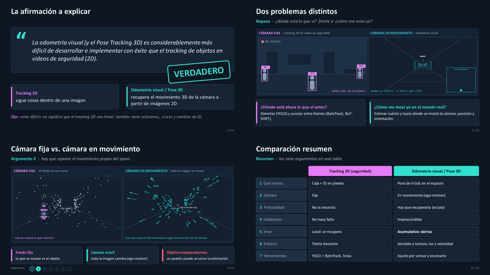

# Etapa 02, ítem a: ¿por qué la odometría visual es más difícil que el tracking 2D?

## Planteamiento

> Si el tracking de objetos en videos de seguridad (2D) se implementa con éxito, ¿por qué la odometría visual es más difícil?

La respuesta se presentó como una exposición de 13 diapositivas con siete argumentos, cada uno ilustrado con una animación generada por código.

## Contenido

| Archivo | Función |
|---|---|
| `anims.py` | Genera las 8 animaciones (matplotlib + OpenCV) al tamaño exacto del espacio que ocupan en la diapositiva. |
| `build_deck.py` | Construye la presentación base con python-pptx. |
| `animar.ps1` | Inserta los videos y las animaciones por clic mediante PowerPoint (COM) y exporta las diapositivas a PNG. |
| `videos/*_final.png` | Último frame de cada animación. |
| `diapositivas.png` | Vista general de las 13 diapositivas. |

Animaciones: `dos_problemas` (tracking 2D frente a OV), `seis_gdl` (6 grados de libertad), `profundidad` (ambigüedad de escala), `ego_motion`, `deriva` (acumulación del error), `ransac` (outliers), `textura` (escenas sin textura) y `calibracion`.

## Ejecución

```bash
pip install opencv-python numpy matplotlib python-pptx lxml
python anims.py                 # renderiza todas las animaciones en videos/ (requiere ffmpeg)
python anims.py deriva          # solo una
python build_deck.py            # crea base.pptx
powershell -ExecutionPolicy Bypass -File animar.ps1   # Windows con PowerPoint instalado
```

Los `.mp4` no se versionan; se regeneran con `anims.py`.

## Resultado


