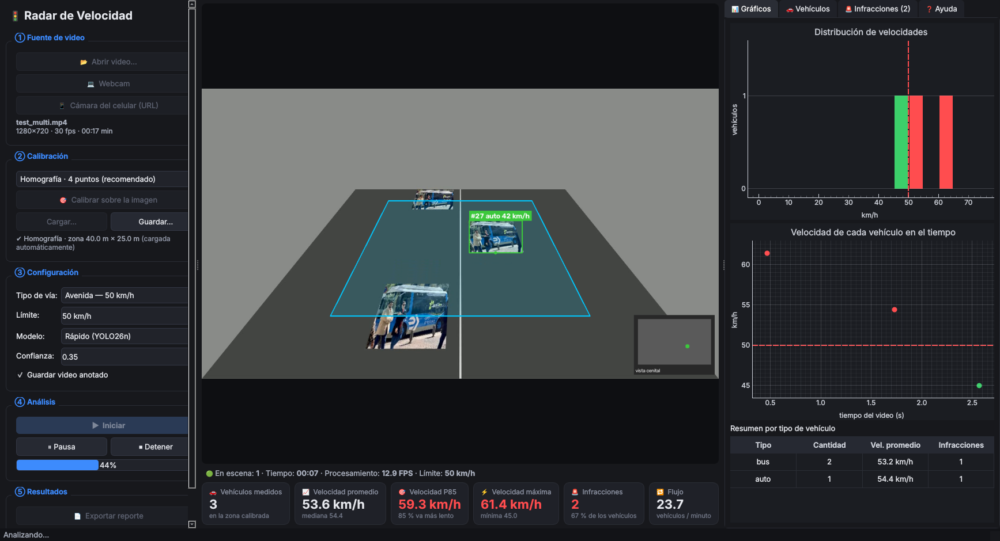

# Etapa 03, Nivel 1: radar de velocidad con cámara fija

Parte del proyecto integrador «Monitor Inteligente de Tráfico y Navegación».

## Objetivo

Detectar vehículos con YOLO, seguirlos con tracking 2D y calcular su velocidad en km/h a partir de una distancia real medida en Google Maps. Como reto, la caja del vehículo se muestra en rojo cuando supera el límite de velocidad.



## Método

1. **Detección y seguimiento:** YOLO26 detecta autos, motos, buses y camiones (clases COCO), y ByteTrack asigna un identificador a cada vehículo.
2. **Punto de medición:** se usa el centro inferior de la caja, es decir, el punto de contacto con la calzada. Es el único punto que está sobre el plano calibrado.
3. **Calibración (píxel → metro):**
   - **Homografía:** cuatro esquinas de un rectángulo real, con su ancho y largo medidos en Google Maps. Corrige la perspectiva.
   - **Factor de escala (px/m):** dos puntos y la distancia entre ellos. Solo es exacto si la cámara mira la calle de costado.
4. **Tiempo:** en un video se usa el reloj del propio video (frame / fps), de modo que la velocidad de procesamiento no altera la medición. En vivo se usa el reloj real.
5. **Velocidad:** regresión lineal de la posición respecto al tiempo en una ventana de 1 s, convertida a km/h (× 3,6).
   - En pantalla se muestra la mediana de las últimas 10 estimaciones.
   - La velocidad registrada de cada vehículo es la mediana de todas sus estimaciones.
6. **Filtros:** se descartan las cajas cortadas por el borde de la imagen, los saltos de más de 250 km/h (cambios de identificador) y las detecciones fuera de la zona calibrada.
7. **Alerta visual:** la caja se muestra en verde por debajo del 90 % del límite, en naranja entre el 90 % y el límite, y en rojo con el texto «EXCESO DE VELOCIDAD» por encima del límite. La infracción se confirma con la velocidad registrada, no con un pico momentáneo.

Límites de referencia en zona urbana (D.S. 025-2021-MTC): 30 km/h en calles y jirones, y 50 km/h en avenidas.

## Instalación y ejecución

```bash
pip install -r requirements.txt
python app.py
```

En Windows también se puede ejecutar `iniciar.bat`, que instala las dependencias y abre la aplicación. `radar_velocidad.py` es una versión por consola, sin interfaz gráfica.

Flujo de uso:

1. **Fuente:** archivo de video, webcam o cámara del celular mediante la aplicación IP Webcam (`http://<IP>:8080/video`).
2. **Calibración:** se marcan los puntos de referencia sobre la imagen y se ingresan las distancias medidas en Google Maps. La calibración se guarda como `<video>.calib.json` y se carga automáticamente la próxima vez.
3. **Configuración:** límite de velocidad, modelo (YOLO26n, s o m), confianza y resolución de entrada.
4. **Análisis y exportación:** se genera un reporte HTML, un CSV de vehículos, el video anotado y las fotos de los infractores en `resultados/`.

## Validación

El video sintético `ejemplo/ejemplo_trafico.mp4` contiene 10 vehículos a velocidades conocidas, y su calibración se carga automáticamente.

| Real (km/h) | 25 | 28 | 30 | 35 | 38 | 42 | 45 | 48 | 55 | 62 |
|---|---|---|---|---|---|---|---|---|---|---|
| Medida (km/h) | 24,8 | 27,9 | 29,9 | 34,5 | 37,9 | 41,6 | 45,0 | 47,5 | 54,4 | 61,4 |

El error es menor al 1,5 % en todos los casos.

## Resultados con video real

Video de una cámara pública fija sobre el puente Moravní most (Uherské Hradiště, República Checa), grabado de noche. Zona calibrada de 13,4 m × 75,5 m, con una escala de 8,3 a 27,2 px/m.

| Indicador | Valor |
|---|---|
| Vehículos medidos | 14 (11 autos y 3 camiones) |
| Velocidad mediana / P85 | 37,3 km/h / 47,9 km/h |
| Rango de velocidades | 24,2 a 58,2 km/h |
| Infracciones (límite de 46 km/h) | 5 de 14 (35,7 %) |

La salida completa de esta corrida está en `resultados/puente_uherske_20261120/`.

## Estructura

| Archivo o carpeta | Descripción |
|---|---|
| `app.py` | Interfaz gráfica (PySide6 + pyqtgraph) |
| `motor.py` | Núcleo: calibración, seguimiento y estimación de velocidad |
| `radar_velocidad.py` | Versión por consola |
| `ejemplo/` | Video sintético de validación, su calibración y el resultado anotado |
| `videos/` | Calibraciones (`.calib.json`) de los videos reales. Los videos no se incluyen por su tamaño |
| `resultados/` | Resultados de la corrida presentada en el informe |
| `capturas/`, `guia_calibracion*.jpg` | Capturas de la aplicación y guía de los puntos de calibración |

## Limitaciones

- Se asume que la calzada es plana.
- La detección empeora de noche, con lluvia y cuando los vehículos se ocultan entre sí.
- Los vehículos lejanos ocupan pocos píxeles, por lo que su medición es menos precisa.
- La cámara no debe moverse después de la calibración. Para cámara en movimiento, véase el Nivel 3.
