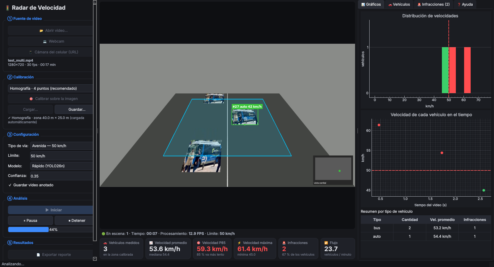

# 🚦 Radar de Velocidad — Nivel 3 (cámara fija y cámara móvil)

Aplicación de escritorio que detecta vehículos con **YOLO26**, los sigue con **ByteTrack** (cámara fija) o **BoTSORT** (cámara en movimiento), calcula su velocidad en **km/h** y marca en **rojo** a los que superan el límite. Compensa el movimiento de la cámara con **odometría visual (ORB)** cuando grabas en movimiento. Además genera estadísticas en vivo, tabla de vehículos, gráficos y un reporte HTML.



## Instalación (una sola vez)
Necesitas **Python 3.10 o superior**.
```bash
pip install -r requirements.txt
```
- **Windows:** doble clic en `iniciar.bat`, que instala las dependencias y abre la app.
- **Linux / Mac:** ejecuta `python app.py`.

Los modelos YOLO26 ya vienen incluidos en el repositorio (`yolo26n.pt`, `yolo26s.pt`, `yolo26m.pt`). Si falta alguno, se descarga automáticamente la primera vez que se usa.

## Pruébalo ya con el ejemplo
1. Abre la app → **📂 Abrir video…** → elige `ejemplo/ejemplo_trafico.mp4`.
2. La calibración se carga sola porque el archivo `ejemplo_trafico.calib.json` está al lado del video.
3. En Tipo de vía elige *Avenida — 50 km/h* y pulsa **▶ Iniciar**.

Es un video sintético con vehículos a velocidades conocidas, útil para verificar que la medición es correcta.

## Uso con tu propio video (paso a paso)
| Paso | Qué haces |
|---|---|
| **① Fuente** | Abre un video (`mp4`, `avi`, `mov`…), usa la **webcam** o la **cámara del celular** con la app *IP Webcam* (URL tipo `http://IP:8080/video`, PC y celular en la misma Wi-Fi). |
| **② Calibración** | Pulsa **🎯 Calibrar sobre la imagen** y haz clic sobre las referencias del suelo. Luego escribe las distancias reales que mediste en **Google Maps** (clic derecho → *Medir distancia*). |
| **③ Configuración** | Elige Tipo de vía / límite, modelo (rápido, balanceado o preciso), confianza y opcionalmente marca **Guardar video anotado** y **Cámara en movimiento**. |
| **④ Análisis** | Pulsa **▶ Iniciar** · **⏸ Pausa** · **⏹ Detener**. El límite se puede cambiar incluso mientras se analiza. |
| **⑤ Resultados** | **📄 Exportar reporte** (HTML + CSV + fotos) · **📁 Abrir carpeta de resultados**. |

La pestaña **❓ Ayuda** de la app explica todo esto en detalle.

### ¿Qué video sirve?
- Cámara **fija** (sin movimiento ni zoom), grabada desde un lugar **alto**.
- Un tramo de calle **recto**, de día y con 15–30 m visibles.
- Referencias en el piso que puedas medir en Google Maps: paso peatonal, postes, bordes de la calzada.
- Si usas **cámara en movimiento**, graba primero unos segundos quieto para calibrar y luego camina/rueda normalmente; la app compensa el desplazamiento.

### Calibración con Google Maps
Busca la calle en vista satélite → **clic derecho → Medir distancia**.
- **Homografía (recomendado):** 4 esquinas de un rectángulo real sobre la pista, en este orden: superior-izquierda → superior-derecha → inferior-derecha → inferior-izquierda, más su ancho y largo en metros. Corrige la perspectiva, así que funciona aunque la cámara mire en diagonal. Mientras más larga sea la zona (20–30 m), más estable la medición. **Obligatorio para cámara en movimiento.**
- **Escala (px/m):** 2 puntos y su distancia real. Solo es exacta si la cámara mira la calle de costado.

La calibración se guarda como `<video>.calib.json` (o `calibracion_camara.json` para webcam/celular) y se carga sola la próxima vez que abras esa fuente.

## Qué muestra la app
- **Video en vivo:** caja 🟢 bajo el límite, 🟠 por encima del 90 % del límite, 🔴 **sobre el límite**, con el texto "EXCESO DE VELOCIDAD" parpadeando. Para cámara fija con homografía incluye un **minimapa con vista cenital**.
- **Indicadores (tarjetas):** vehículos medidos, velocidad promedio y mediana, **P85** (velocidad que el 85 % de los vehículos no supera; estándar en ingeniería de tránsito), velocidad máxima, vehículos en movimiento y flujo en vehículos por minuto.
- **📊 Gráficos:** histograma de velocidades con la línea del límite, velocidad de cada vehículo en el tiempo y resumen por tipo de vehículo.
- **🚗 Vehículos:** tabla en tiempo real con ID, tipo, velocidad actual, máxima, sentido (↑↓←→), tiempo y estado; se puede ordenar por cualquier columna.
- **🚨 Infracciones:** se guarda una foto de cada vehículo que supera el límite en la carpeta de resultados (`infracciones/`). Si al final la velocidad registrada no superó el límite, la foto se descarta.
- **📄 Reporte:** en `resultados/<fecha>_<fuente>/` quedan `reporte.html`, `vehiculos.csv`, `video_anotado.mp4` (si se activó), `captura.jpg` y la carpeta `infracciones/`.

## Cámara en movimiento (Nivel 3)
Marca la casilla **Cámara en movimiento (odometría visual)** para analizar videos grabados desde un vehículo o mientras caminas. La app:
- Usa **ORB + RANSAC** con un **keyframe** para compensar el desplazamiento de la cámara respecto al suelo.
- Ignora el cielo, los edificios lejanos, los vehículos y las personas al estimar el movimiento de la cámara.
- Mide la velocidad **absoluta** de cada vehículo (no relativa a la cámara).
- Requiere calibración con **homografía** (4 puntos) hecha con la cámara quieta en el primer frame.
- Usa el tracker **BoTSORT** en lugar de ByteTrack.

## Cómo se calcula la velocidad
1. **Detección:** YOLO26 (clases COCO: auto, moto, bus, camión; además persona si hay odometría, solo para enmascararla). **Tracking:** ByteTrack (cámara fija) o BoTSORT (cámara móvil) asigna un ID a cada vehículo.
2. **Punto de medición:** el centro inferior de la caja, donde la llanta toca el piso — el único punto realmente sobre la pista.
3. **Píxel → metro:** con la homografía (vista cenital) o con el factor de escala (px/m).
4. **Tiempo:** en video se usa el reloj del propio video (frame / fps), así una PC lenta no altera el resultado. En vivo se usa el reloj real.
5. **Velocidad:** regresión lineal de la posición contra el tiempo en una ventana deslizante de 1 s. La mostrada es la mediana de las últimas 10 estimaciones; la **registrada** es la mediana de todas las estimaciones del vehículo.
6. **Filtros:** se descartan cajas cortadas por el borde, saltos imposibles de velocidad (cambio de ID) y lo que está fuera de la zona calibrada. La clase se decide por voto mayoritario de las detecciones.
7. **Infracción:** se confirma con la velocidad registrada, no con un pico momentáneo.

Límites urbanos en Perú (D.S. 025-2021-MTC): **30 km/h** en calles y jirones, **50 km/h** en avenidas. La app incluye además presets de 30 km/h (zona escolar/hospital) y 80 km/h (vía expresa), más un límite personalizado.

## Archivos
| Archivo | Para qué |
|---|---|
| `app.py` | Aplicación gráfica (PySide6 + pyqtgraph) |
| `motor.py` | Núcleo: calibración, odometría visual, tracking y estimación de velocidad |
| `radar_velocidad.py` | Versión por consola (opcional): `python radar_velocidad.py --fuente video.mp4 --limite 50` |
| `iniciar.bat` | Lanzador para Windows (instala dependencias y abre `app.py`) |
| `requirements.txt` | Dependencias de Python |
| `ejemplo/` | Video de prueba ya calibrado (`ejemplo_trafico.mp4` + `ejemplo_trafico.calib.json`) |
| `yolo26n.pt`, `yolo26s.pt`, `yolo26m.pt` | Modelos YOLO26 (rápido / balanceado / preciso) |
| `resultados/` | Carpetas de salida generadas por cada análisis |

## Versión de consola
También se puede usar sin interfaz gráfica:
```bash
python radar_velocidad.py --fuente trafico.mp4 --limite 30 --modelo yolo26m.pt --guardar salida.mp4
python radar_velocidad.py --fuente 0                              # webcam
python radar_velocidad.py --fuente http://IP:8080/video           # celular (IP Webcam)
```
Teclas: `q`/`ESC` salir · `p` pausa · `+`/`-` subir/bajar límite 5 km/h. El detalle se guarda en `infracciones/vehiculos.csv`.

## Limitaciones
- Se asume que la pista es **plana**.
- De noche, con lluvia o con vehículos muy tapados entre sí, baja la detección.
- Los vehículos lejanos ocupan pocos píxeles: usa **Preciso (YOLO26m)** o acerca la zona de calibración.
- Con cámara en movimiento, la medición es fiable solo sobre el suelo cercano y cuando la odometría logra suficientes referencias estáticas.
