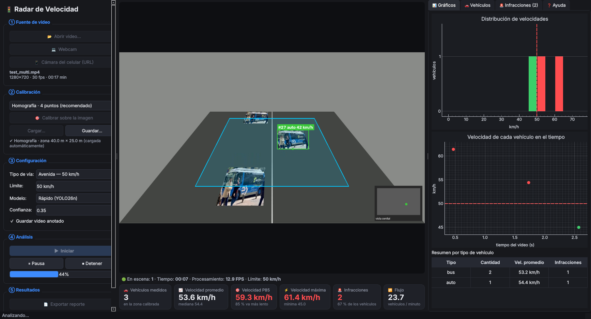

# 🚦 Radar de Velocidad — Nivel 1 (cámara fija)

Aplicación de escritorio que detecta vehículos con **YOLO26**, los sigue con **ByteTrack**, calcula su velocidad en **km/h** y marca en **rojo** a los que superan el límite. Además genera estadísticas y un reporte.



## Instalación (una sola vez)
Necesitas **Python 3.10 o superior**.
```bash
pip install -r requirements.txt
```
- **Windows:** doble clic en `iniciar.bat`, que instala todo y abre la app.
- **Linux / Mac:** ejecuta `python app.py`.

El modelo YOLO26 se descarga solo la primera vez (unos 6 MB).

## Pruébalo ya con el ejemplo
1. Abre la app → **📂 Abrir video…** → elige `ejemplo/ejemplo_trafico.mp4`.
2. La calibración se carga sola, porque el archivo `ejemplo_trafico.calib.json` está al lado del video.
3. En Tipo de vía elige *Avenida — 50 km/h* y pulsa **▶ Iniciar**.

Es un video sintético con 10 vehículos a velocidades conocidas. Se usa para verificar que la medición es correcta:

| Real (km/h) | 25 | 28 | 30 | 35 | 38 | 42 | 45 | 48 | 55 | 62 |
|---|---|---|---|---|---|---|---|---|---|---|
| Medido | 24,8 | 27,9 | 29,9 | 34,5 | 37,9 | 41,6 | 45,0 | 47,5 | 54,4 | 61,4 |

El error es menor al 1,5 % en todos los casos.

## Uso con tu propio video (paso a paso)
| Paso | Qué haces |
|---|---|
| **① Fuente** | Abre un video, usa la webcam o el celular (app *IP Webcam* → URL `http://IP:8080/video`) |
| **② Calibración** | Pulsa **Calibrar sobre la imagen** y haz clic sobre las referencias. Luego escribe las distancias medidas en Google Maps |
| **③ Configuración** | Tipo de vía / límite, modelo (rápido, balanceado o preciso), confianza |
| **④ Análisis** | ▶ Iniciar · ⏸ Pausa · ⏹ Detener. El límite se puede cambiar en pleno análisis |
| **⑤ Resultados** | 📄 Exportar reporte (HTML + CSV + fotos) · 📁 Abrir carpeta |

La pestaña **❓ Ayuda** de la app explica todo esto en detalle.

### ¿Qué video sirve?
- Cámara **fija** (sin movimiento ni zoom), grabado desde un lugar **alto**.
- Un tramo de calle **recto**, de día y con 15–20 m visibles.
- Referencias en el piso que puedas medir en Google Maps: paso peatonal, postes, bordes de la calzada.
- Ubicación conocida, para poder medirla.

### Calibración con Google Maps
Busca la calle en vista satélite → **clic derecho → Medir distancia**.
- **Homografía (recomendado):** 4 esquinas de un rectángulo real, en el orden sup-izq → sup-der → inf-der → inf-izq, más su ancho y largo. Corrige la perspectiva, así que funciona con la cámara en diagonal.
- **Escala px/m:** 2 puntos y su distancia (es lo que pide el enunciado). Solo es exacta si la cámara mira la calle de costado.

La calibración se guarda como `<video>.calib.json` y se carga sola la próxima vez que abras ese video.

## Qué muestra la app
- **Video en vivo:** caja 🟢 bajo el límite, 🟠 por encima del 90 % del límite, 🔴 **sobre el límite**, con el texto "EXCESO DE VELOCIDAD" parpadeando. Incluye un minimapa con la vista cenital.
- **Indicadores:** vehículos medidos, velocidad promedio y mediana, **P85** (el estándar en ingeniería de tránsito), velocidad máxima, infracciones (número y %), y flujo en vehículos por minuto.
- **📊 Gráficos:** histograma con la línea del límite, velocidad de cada vehículo en el tiempo y resumen por tipo (auto, moto, bus, camión).
- **🚗 Vehículos:** tabla ordenable con ID, tipo, velocidad, sentido (↑↓←→), tiempo y estado, más un filtro "solo infracciones".
- **🚨 Infracciones:** galería con la foto de cada infractor (doble clic para ampliar).
- **📄 Reporte:** en `resultados/<fecha>_<video>/` quedan `reporte.html`, `vehiculos.csv`, `video_anotado.mp4`, `captura.jpg` y la carpeta `infracciones/`.

## Cómo se calcula la velocidad
1. **Detección:** YOLO26 (clases COCO auto, moto, bus y camión). **Tracking:** ByteTrack asigna un ID por vehículo.
2. **Punto de medición:** el centro inferior de la caja, donde la llanta toca el piso, que es el único punto realmente sobre la pista.
3. **Píxel → metro:** con la homografía (vista cenital) o con el factor de escala.
4. **Tiempo:** en un video se usa el reloj del propio video (frame / fps), así una PC lenta no altera el resultado. En vivo se usa el reloj real.
5. **Velocidad:** regresión lineal de la posición contra el tiempo en una ventana de 1 s. La que se muestra es la mediana de las últimas 10 estimaciones. La **registrada** es la mediana de todas las estimaciones del vehículo.
6. **Filtros:** se descartan las cajas cortadas por el borde de la imagen, los saltos de más de 250 km/h (cambio de ID) y lo que está fuera de la zona calibrada. La clase se decide por voto mayoritario.
7. **Infracción:** se confirma con la velocidad registrada, no con un pico momentáneo. Si al final no superó el límite, la foto se descarta.

Límites urbanos en Perú (D.S. 025-2021-MTC): **30 km/h** en calles y jirones, **50 km/h** en avenidas.

## Archivos
| Archivo | Para qué |
|---|---|
| `app.py` | Aplicación gráfica (PySide6 + pyqtgraph) |
| `motor.py` | Núcleo: calibración, tracking y estimación de velocidad |
| `radar_velocidad.py` | Versión por consola (opcional) |
| `iniciar.bat` | Lanzador para Windows |
| `ejemplo/` | Video de prueba ya calibrado |

## Limitaciones
- Se asume que la pista es plana.
- De noche, con lluvia o con autos muy tapados entre sí, baja la detección.
- Los autos lejanos ocupan pocos píxeles. Usa `Preciso (YOLO26m)` o acerca la zona de calibración.
